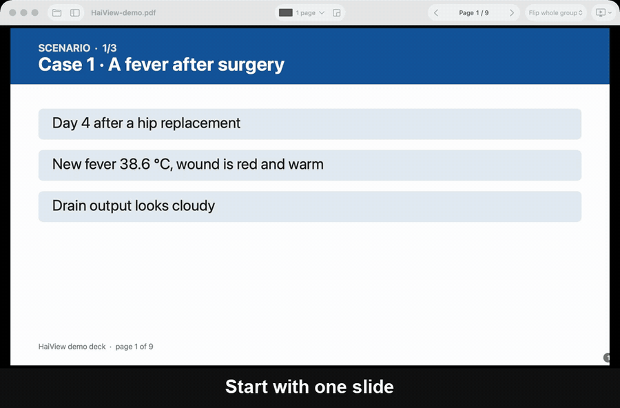
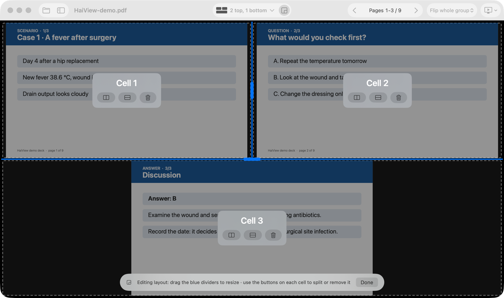
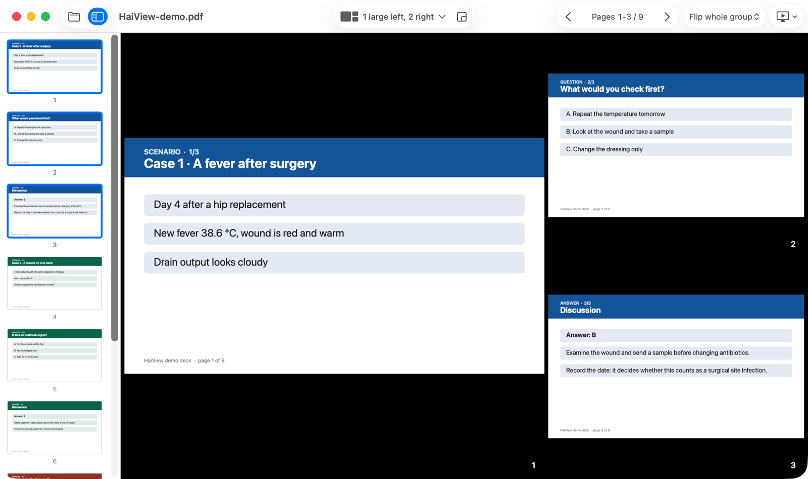

<p align="center">
  
</p>

<h1 align="center">HaiView</h1>

<p align="center">
  <b>Show 3 slides at once. Or 2, or 5, in any layout you like.</b><br>
  A free, fast presenter for PDF and PowerPoint that puts several pages on one screen,
  built for teachers who project quizzes, cases and worked examples.
</p>

<p align="center">
  <a href="../../releases/latest"><b>Download for macOS</b></a> ·
  <a href="../../releases/latest"><b>Download for Windows</b></a> ·
  <a href="README.vi.md">Tiếng Việt</a>
</p>

<p align="center">
  <a href="../../releases/latest"></a>
  
  <a href="LICENSE"></a>
  <a href="../../stargazers"></a>
</p>

<p align="center">
  
</p>

## Why HaiView?

A quiz or a clinical case rarely fits on one slide. The question is on slide 1, the data on slide 2, the answer on slide 3, and your audience can only see one at a time.

The multi-page view built into most viewers only offers fixed grids of 2, 4 or 6 pages. HaiView lets you decide:

- **Three slides on one screen**, side by side, two on top and one below, or one large with two small.
- **Your own layout**: drag the dividers to make any area wider or narrower, split a cell, remove a cell, then save the layout with a name.
- **Flip the whole group** with one key press: the next three slides replace the current three.
- **Flip one cell on its own**: keep the question on screen and change only the answer cell.
- **Open PowerPoint directly**: drop a `.pptx` file and HaiView converts it with your own PowerPoint, so fonts and layout look exactly right.
- **Made for projectors and TVs**: send the window to the second screen in one click, black out the screen with `B`, use your presentation clicker.

HaiView works offline, collects no data and is open source under the MIT license.

## Screenshots

| Edit any layout | Page list: drop a page into a cell |
|---|---|
|  |  |

## Download

Go to the [latest release](../../releases/latest) and pick the file for your computer.

| Computer | File | Requirements |
|---|---|---|
| Mac (Apple silicon and Intel) | `HaiView-x.y.z-macOS.zip` | macOS 15 Sequoia or later |
| Windows PC (most laptops and desktops) | `HaiView-x.y.z-Windows-x64.zip` | Windows 10 (2004) or Windows 11 |
| Windows on ARM (Surface Pro X, Snapdragon laptops) | `HaiView-x.y.z-Windows-arm64.zip` | Windows 11 |

Opening `.pptx` files needs Microsoft PowerPoint on the same computer. PDF files work everywhere.

### First launch

HaiView is not yet signed with a paid developer certificate, so your computer will ask once whether you trust it.

**macOS:** unzip, move `HaiView.app` to Applications, then **right-click the app and choose Open**, and confirm. If macOS still refuses, open System Settings → Privacy & Security and click **Open Anyway**.

**Windows:** unzip and run `HaiView.exe`. If you see "Windows protected your PC", click **More info** → **Run anyway**. No installer and no extra runtime are needed.

## Quick start

1. **Open** a PDF or PowerPoint file (drag it onto the window).
2. **Pick a layout** from the layout button in the toolbar, for example *2 top, 1 bottom*.
3. **Present**: choose your projector or TV from the *Present* menu. Press `→` to show the next group of slides.

## Keyboard and clicker

| Key | Action |
|---|---|
| `→` `↓` `Space` `PageDown` | Next group (or next page, see the *Flip* setting) |
| `←` `↑` `PageUp` | Previous group |
| `Shift` + `→` / `←` | Move by one page |
| Type a number, then `Enter` | Go to that page |
| Click a cell | Select it: arrow keys now flip only that cell. `Esc` to deselect |
| Double-click a cell | Zoom that cell to the full screen |
| `B` or `.` | Black screen |
| `F` (Windows also `F5`) | Full screen |
| `E` | Edit layout: resize, split, remove cells |
| `T` | Page list |
| `H` | Show or hide page numbers |
| `R` | Reset all cells to consecutive pages |
| `Esc` | Leave black screen, edit mode, zoom or full screen |

Most presentation clickers send `PageDown` and `PageUp`, so they work out of the box.

## Layouts

Built in: 1 page · 2 side by side · 2 stacked · 3 side by side · 2 top, 1 bottom · 1 top, 2 bottom · 1 large + 2 small (left or right) · grid 2 × 2 · grid 2 × 3 · any grid up to 4 × 5.

Need something else? Press `E`, split and resize the cells until the layout fits your slides, then save it. Up to 16 cells.

**Tip for 16:9 screens:** *2 top, 1 bottom* makes each slide half the screen width, which is much easier to read from the back of the room than *3 side by side*.

## Build from source

```bash
# macOS (Swift 6, Command Line Tools are enough)
./macos/build.sh --install

# Windows (any OS with the .NET 10 SDK)
./windows/build.sh
```

Packages land in `dist/`. The Mac app uses SwiftUI and PDFKit. The Windows app uses WPF and the PDF engine built into Windows. Both convert PowerPoint files by automating the PowerPoint installed on the computer.

## Roadmap

- Different files in different cells (for example a question deck next to an answer deck)
- Presenter view: control on the laptop, clean output on the projector
- Signed and notarized builds, Homebrew and winget packages

Ideas are welcome in [Discussions](../../discussions), bug reports in [Issues](../../issues). Tell us how you teach with it: real classroom stories decide what comes next.

## About

HaiView was made by a hospital infection control trainer who kept needing to show a three-slide quiz on one projector. If HaiView helps your teaching, please **star the repo** ⭐ at the top of this page. It is the easiest way to help other teachers find it.

## License

[MIT](LICENSE). Free for personal, classroom and commercial use.
