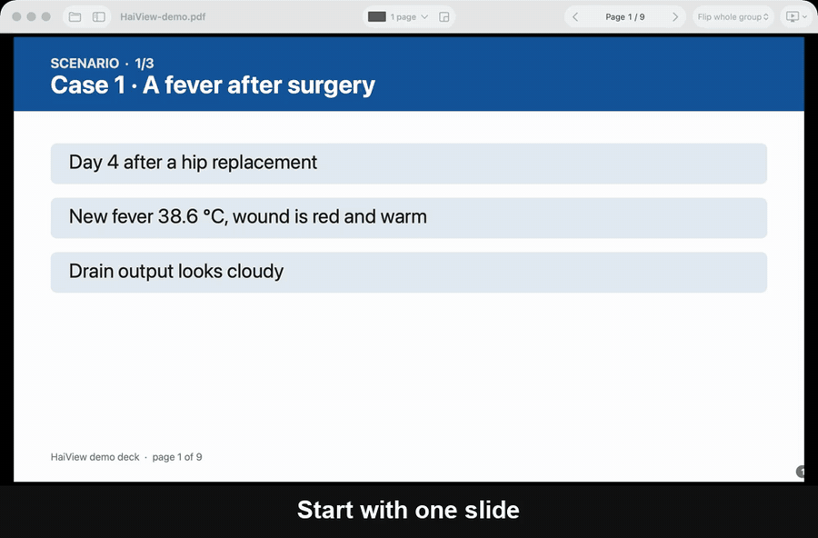

<p align="center">
  
</p>

<h1 align="center">HaiView</h1>

<p align="center">
  <b>Chiếu 3 slide cùng lúc. Hay 2, hay 5, theo bố cục bạn muốn.</b><br>
  Ứng dụng miễn phí để chiếu nhiều trang PDF hoặc PowerPoint trên một màn hình,
  làm cho giảng viên hay phải chiếu đề, ca lâm sàng và bài giải nhiều slide.
</p>

<p align="center">
  <a href="../../releases/latest"><b>Tải cho Mac</b></a> ·
  <a href="../../releases/latest"><b>Tải cho Windows</b></a> ·
  <a href="README.md">English</a>
</p>

<p align="center">
  
</p>

## Vì sao có HaiView?

Một đề hay một ca bệnh hiếm khi gói trong một slide: câu hỏi ở slide 1, dữ kiện ở slide 2, đáp án ở slide 3, mà máy chiếu chỉ cho học viên thấy từng slide một.

Chế độ xem nhiều trang có sẵn trong các trình xem chỉ cho lưới cố định 2, 4 hoặc 6 trang. HaiView để bạn tự quyết:

- **Ba slide trên một màn hình**: cạnh nhau, 2 trên 1 dưới, hoặc 1 lớn 2 nhỏ.
- **Bố cục của riêng bạn**: kéo đường chia để vùng nào rộng hay hẹp tùy ý, chia đôi ô, xoá ô, rồi lưu lại với tên riêng.
- **Lật cả nhóm** bằng một phím: 3 slide kế tiếp thay cho 3 slide hiện tại.
- **Lật riêng một ô**: giữ câu hỏi trên màn hình, chỉ đổi ô đáp án.
- **Mở thẳng PowerPoint**: kéo file `.pptx` vào, HaiView nhờ chính PowerPoint trên máy chuyển sang PDF nên phông chữ và bố cục giữ nguyên.
- **Làm cho máy chiếu và TV**: một cú bấm để đưa sang màn hình thứ hai, phím `B` để tắt đen màn hình, dùng được bút trình chiếu.

HaiView chạy không cần mạng, không thu thập dữ liệu và là mã nguồn mở theo giấy phép MIT.

## Tải về

Vào [bản phát hành mới nhất](../../releases/latest) và chọn file hợp với máy của bạn.

| Máy | File | Yêu cầu |
|---|---|---|
| Mac (chip Apple và Intel) | `HaiView-x.y.z-macOS.zip` | macOS 15 Sequoia trở lên |
| Máy Windows thông thường | `HaiView-x.y.z-Windows-x64.zip` | Windows 10 (2004) hoặc Windows 11 |
| Windows chip ARM (Surface Pro X, laptop Snapdragon) | `HaiView-x.y.z-Windows-arm64.zip` | Windows 11 |

Muốn mở file `.pptx` thì máy cần có Microsoft PowerPoint. File PDF thì mở được ở mọi máy.

### Lần mở đầu tiên

HaiView chưa được ký bằng chứng chỉ nhà phát triển trả phí, nên máy sẽ hỏi một lần là bạn có tin ứng dụng này không.

**Mac:** giải nén, kéo `HaiView.app` vào thư mục Ứng dụng, rồi **chuột phải vào app, chọn Mở** và xác nhận. Nếu vẫn bị chặn, vào Cài đặt hệ thống → Quyền riêng tư & Bảo mật, bấm **Vẫn mở**.

**Windows:** giải nén và chạy `HaiView.exe`. Nếu hiện "Windows protected your PC", bấm **More info** → **Run anyway**. Không cần cài đặt, không cần cài thêm gì.

## Dùng nhanh

1. **Mở** file PDF hoặc PowerPoint (kéo thả vào cửa sổ).
2. **Chọn bố cục** ở nút bố cục trên thanh công cụ, ví dụ *2 trên, 1 dưới*.
3. **Chiếu**: chọn máy chiếu hoặc TV trong menu *Chiếu*. Bấm `→` để sang nhóm slide kế tiếp.

## Phím tắt và bút trình chiếu

| Phím | Tác dụng |
|---|---|
| `→` `↓` `Space` `PageDown` | Nhóm sau (hoặc trang sau, tùy chế độ *Lật*) |
| `←` `↑` `PageUp` | Nhóm trước |
| `Shift` + `→` / `←` | Nhích 1 trang |
| Gõ số rồi `Enter` | Tới trang đó |
| Bấm vào một ô | Chọn ô, phím mũi tên chỉ lật ô đó. `Esc` để bỏ chọn |
| Bấm đúp vào một ô | Phóng to ô đó ra cả màn hình |
| `B` hoặc `.` | Màn hình đen |
| `F` (Windows thêm `F5`) | Toàn màn hình |
| `E` | Sửa bố cục: đổi rộng hẹp, chia, xoá ô |
| `T` | Danh sách trang |
| `H` | Ẩn hoặc hiện số trang |
| `R` | Đưa mọi ô về trang liên tiếp |
| `Esc` | Thoát màn hình đen, chế độ sửa, phóng to hoặc toàn màn hình |

Phần lớn bút trình chiếu gửi phím `PageDown` và `PageUp`, nên dùng được ngay.

## Mẹo cho màn hình 16:9

Bố cục *2 trên, 1 dưới* cho mỗi slide rộng bằng nửa màn hình, học viên ngồi cuối lớp đọc dễ hơn hẳn kiểu *3 trang cạnh nhau*.

## Tự build từ mã nguồn

```bash
# Mac (Swift 6, chỉ cần Command Line Tools)
./macos/build.sh --install

# Windows (máy nào có .NET 10 SDK cũng build được)
./windows/build.sh
```

File đóng gói nằm trong thư mục `dist/`.

## Góp ý

Có ý tưởng hay muốn kể bạn dùng HaiView trong lớp thế nào, viết ở [Discussions](../../discussions). Gặp lỗi thì mở [Issues](../../issues). Nếu app có ích, bấm **Star** ⭐ ở đầu trang để giảng viên khác dễ tìm thấy.

## Giấy phép

[MIT](LICENSE). Dùng miễn phí cho cá nhân, lớp học và cả mục đích thương mại.
